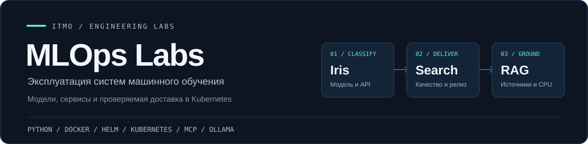
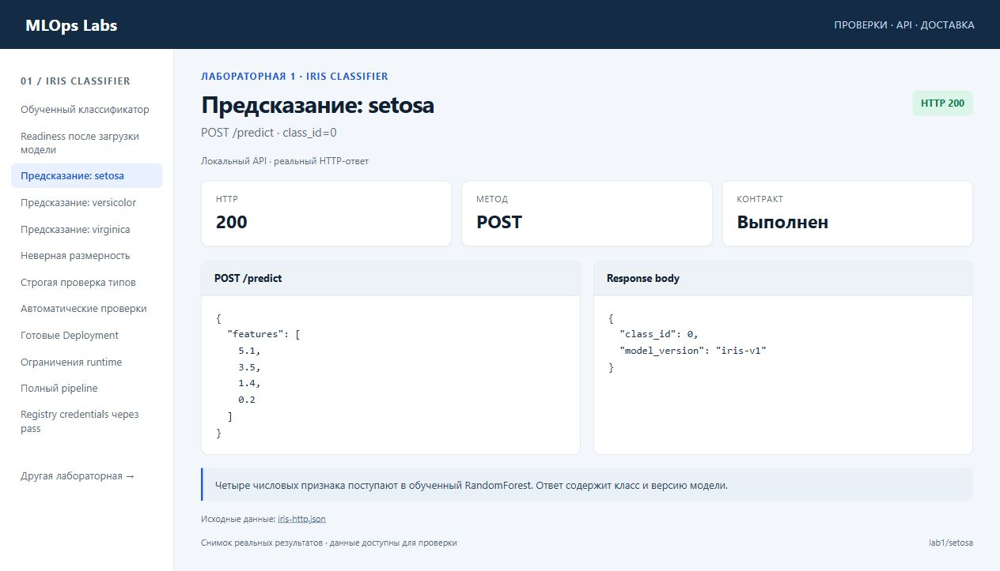
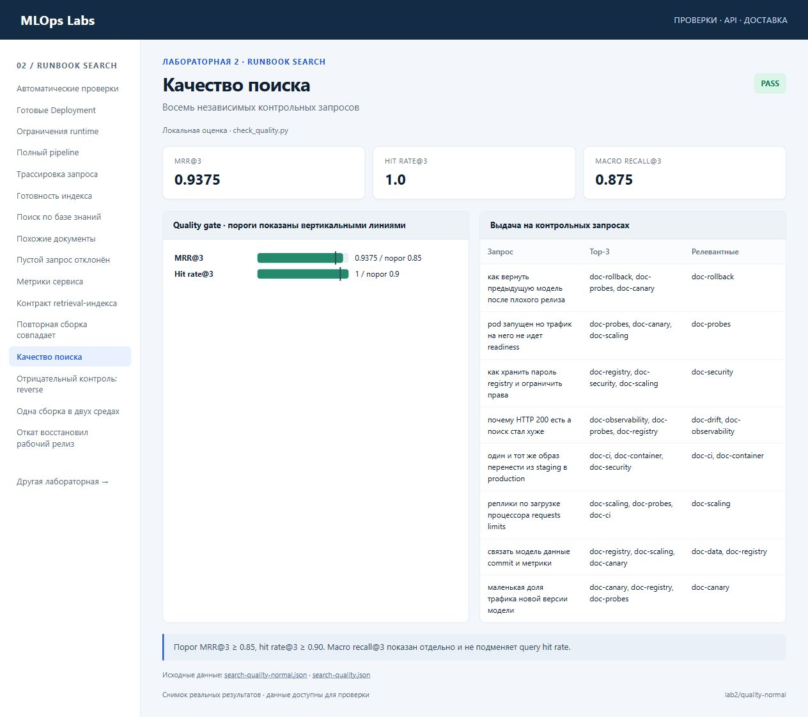
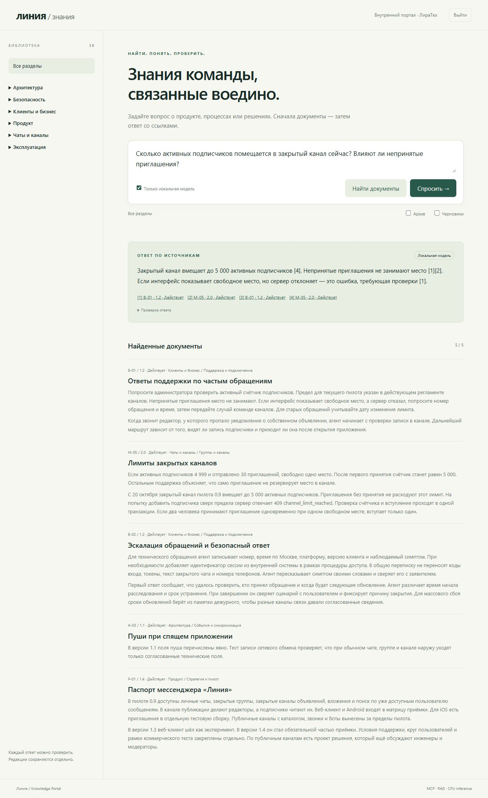

# Эксплуатация систем машинного обучения



[](https://github.com/Ingaleee/itmo-mlops/actions/workflows/ci-cd.yml)
[](https://github.com/Ingaleee/itmo-mlops/actions/workflows/teaching-deploy.yml)
[](https://github.com/Ingaleee/itmo-mlops/actions/workflows/lab3.yml)
[](https://github.com/Ingaleee/itmo-mlops/actions/workflows/lab3-teaching.yml)

Практические проекты MLOps: классификация Iris, поиск по инженерной базе знаний и RAG-портал с MCP и CPU-моделью. В каждом проекте есть приложение, воспроизводимая сборка, Kubernetes-профиль и доказательства работы.

**[Лабораторные](#лабораторные)** · **[Результаты проверок](docs/validation.md)** · **[Запуск](docs/development.md)** · **[CI/CD](docs/delivery.md)** · **[Скриншоты и видео](docs/media/README.md)**

## Лабораторные

| № | Проект | Что проверено | Материалы |
|:--:|---|---|---|
| **01** | **[Iris Classifier](lab1/README.md)**<br>Модель → HTTP API → Kubernetes | 18 тестов, три класса, валидация ввода и учебный deployment | [Условия](lab1/ASSIGNMENT.md) · [Галерея](lab1/DEMO.md) · [Отчёт](docs/verification/lab1.json) |
| **02** | **[Runbook Search](lab2/README.md)**<br>Retrieval → quality gate → promotion | 37 тестов, MRR@3 = 0.9375, один digest в staging/production и настоящий rollback | [Условия](lab2/ASSIGNMENT.md) · [Галерея](lab2/DEMO.md) · [Отчёт](docs/verification/lab2.json) |
| **03** | **[Knowledge Portal](lab3/README.md)**<br>MCP → RAG → Ollama CPU / llm7 | 64 теста, 8/8 CPU-ответов на учебном стенде, очередь, отмена и пересоздание Pod | [Условия](lab3/ASSIGNMENT.md) · [Галерея](lab3/DEMO.md) · [Отчёт](docs/verification/lab3-teaching.json) |

> **Статус ЛР3:** CPU-профиль проверен в учебном Kubernetes. Полный облачный прогон остаётся открытым: исходящий HTTPS к llm7 недоступен, бюджет аккаунта исчерпан, текущая облачная модель не прошла все контрольные условия. Подробности — в [результатах](docs/validation.md#knowledge-portal).

## Посмотреть реализацию

| Iris Classifier | Runbook Search | Knowledge Portal |
|:--:|:--:|:--:|
| [](lab1/DEMO.md) | [](lab2/DEMO.md) | [](lab3/DEMO.md) |
| [API, модель и доставка](lab1/DEMO.md) | [Поиск, promotion и rollback](lab2/DEMO.md) | [Портал, источники и CPU](lab3/DEMO.md) |

Галереи содержат **37 реальных скриншотов и 5 видеообзоров**. У каждого материала указаны источник и проверяемый результат; SHA-256 сохранены в [манифесте](docs/media/manifest.json).

## Проверить результат

| Проверка | Доказательство |
|---|---|
| Iris и Search на учебном стенде | [Pipeline поставки](https://github.com/Ingaleee/itmo-mlops/actions/runs/44913702769) · [Отчёт о deployment и rollback](docs/verification/dockerhub-delivery.json) |
| Knowledge Portal на CPU, исходный корпус | [Pipeline приёмки](https://github.com/Ingaleee/itmo-mlops/actions/runs/45368980625) · [Ответы, ресурсы и сохранность весов](docs/verification/lab3-teaching.json) |
| Все подтверждённые результаты | [Проверки проекта](docs/validation.md) · [Машинный статус](docs/verification/current-delivery.json) |

Первые две работы имеют [Iris API](http://iris.itmo-student-01.mlops.goctf.online/docs), [Search staging](http://search-staging.itmo-student-01.mlops.goctf.online/docs) и [Search production](http://search.itmo-student-01.mlops.goctf.online/docs). Третий профиль запускается отдельно из-за общей квоты памяти; доступ к закрытому порталу — через localhost port-forward.

## Запустить и разобраться

1. **Подготовить окружение:** [Python, Docker и инструменты](docs/development.md). Каждая лабораторная использует отдельное Python-окружение.
2. **Запустить проект:** команды находятся в README выбранной лабораторной; у [Knowledge Portal есть отдельный runbook](lab3/RUNBOOK.md).
3. **Повторить поставку:** [образы, registry, Kubernetes и rollback](docs/delivery.md), [ресурсы и профили учебного кластера](docs/teaching-cluster.md).

## Устройство репозитория

```text
lab1/                   Iris: модель, API, тесты, Docker и Kubernetes
lab2/                   Search: индекс, API, quality gate и Helm
lab3/                   Knowledge Portal: MCP, RAG, Ollama, UI и Kubernetes
.github/workflows/      Сборка, проверки и доставка
scripts/                Общие инструменты CI/CD
docs/
  development.md        Подготовка окружения
  delivery.md           Поставка и восстановление
  validation.md         Подтверждённые результаты
  verification/         Краткие машинные отчёты
  media/                Снимки, видео и их источники
  lab-template.md       Шаблон следующей лабораторной
```

Каждый `labN/` — самостоятельный проект: **README** описывает реализацию, **ASSIGNMENT** сохраняет условия, **DEMO** показывает результаты. Новая работа добавляется по [единому шаблону](docs/lab-template.md); общая навигация остаётся компактной.

## Инженерные решения

- Модели, индексы и образы идентифицируются по версии и SHA-256; между staging и production продвигается одна сборка.
- Контракт API, качество модели и работоспособность установленного релиза проверяются отдельно.
- Production имеет подтверждение; отказ качества вызывает проверенный rollback.
- Контейнеры работают без root, с лимитами ресурсов и read-only filesystem.
- Закрытый корпус, крупные веса и credentials доставляются отдельно от публичного кода и образов.
- Версии зависимостей, базовых образов и GitHub Actions закреплены; результаты связаны с конкретными pipeline.
