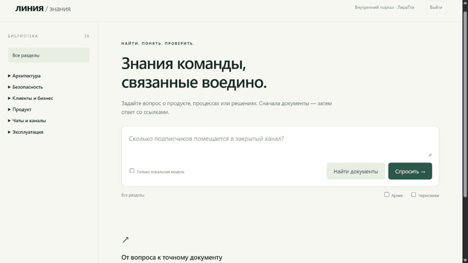
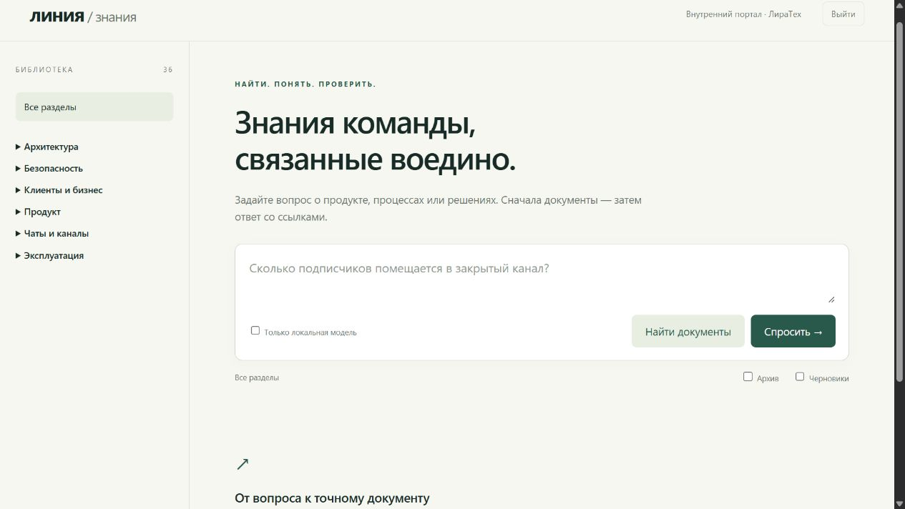
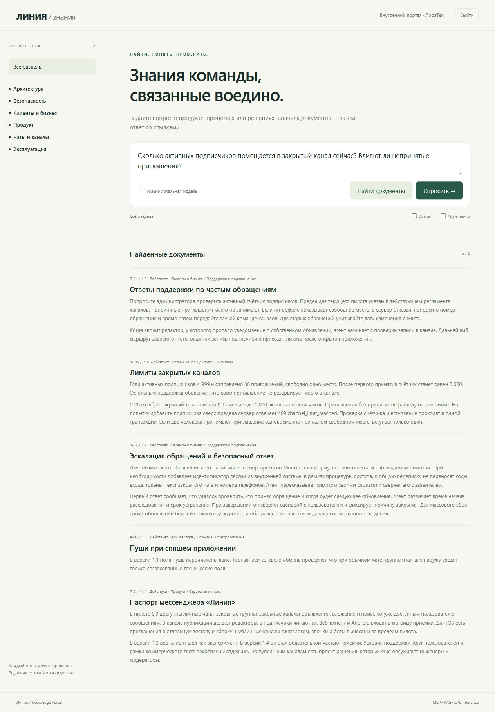

# Knowledge Portal — демонстрация

[Проект](README.md) · [Критерии](ACCEPTANCE.md) · [Результаты](../docs/validation.md#knowledge-portal)

Снимки сделаны в настоящем локальном портале, подключённом к отдельному MCP-процессу и Ollama CPU. Это демонстрация локального приложения; она не подменяет проверку учебного Kubernetes. Закрытый документ и секреты в кадры не включены.

## Видеообзор

[MP4, 25 секунд](../docs/media/lab3/portal-demo.mp4). Видео составлено из последовательности реальных браузерных снимков с кадрированием до viewport. Это обзор экранов, не непрерывная запись действий.

## Портал

Вход защищён отдельным токеном. Браузер работает только с backend портала. Дерево содержит 36 редакций; архивные версии не объединяются с действующими.

## Поиск

Результаты получены через MCP. Карточки показывают точную версию, статус и выдержки. [Независимая проверка MCP](../docs/media/sources/knowledge-mcp.json) содержит схемы трёх инструментов и источники контрольных вопросов.

## Настоящий CPU-ответ

Выбран локальный маршрут. Ответ и карта источников сформированы после поиска, а не заранее записаны в интерфейсе. [Проверка приватности](../docs/media/sources/knowledge-privacy.json) подтверждает происхождение открытых контрольных контекстов. [Отмена в настоящем runtime](../docs/media/sources/knowledge-native-cancellation.json) фиксирует доступность следующего запроса после отмены.

## Действующая редакция

Точный URL `/docs/M-05/2.0` открывает действующую редакцию с пределом 5000. Секция имеет собственный якорь.

## Архивная редакция

URL `/docs/M-05/1.1` отдельно открывает архив с прежним пределом 1000. Статус виден в метаданных.

SHA-256, размеры изображений, происхождение и связи с исходными данными записаны в [манифесте](../docs/media/manifest.json).
