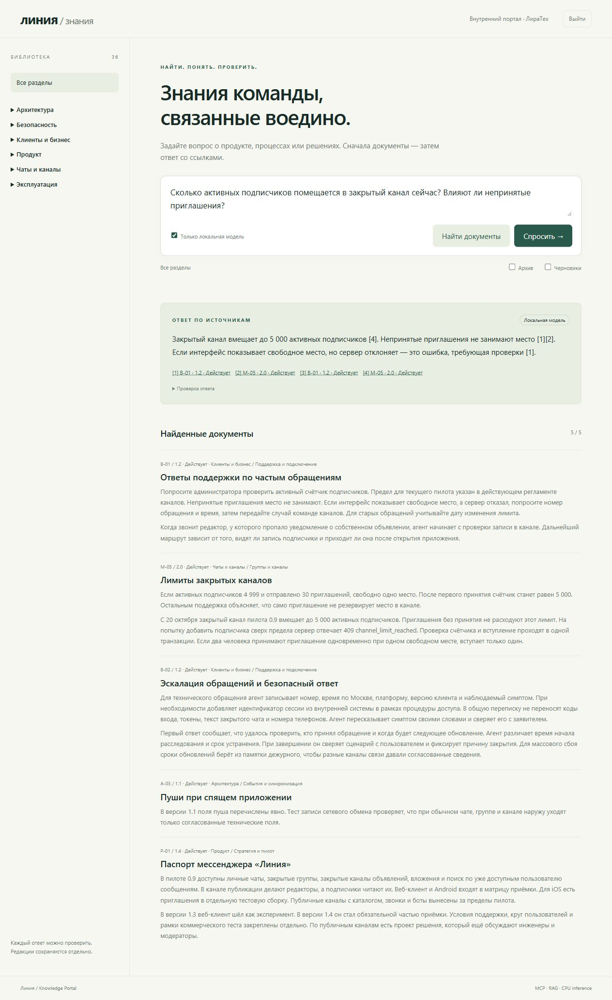
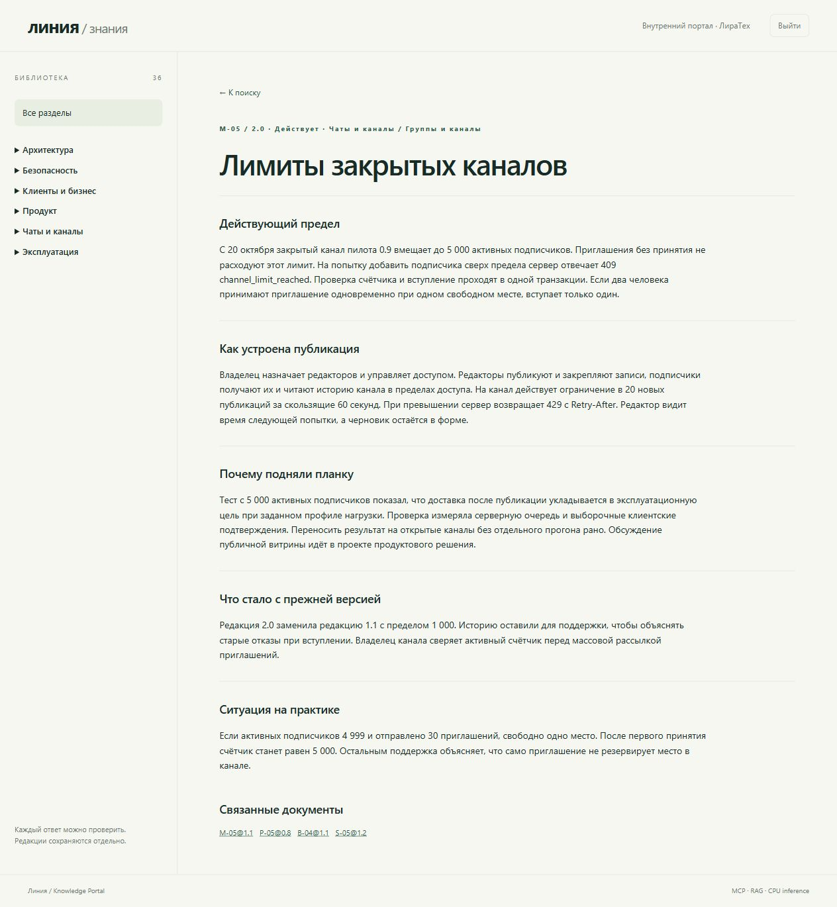
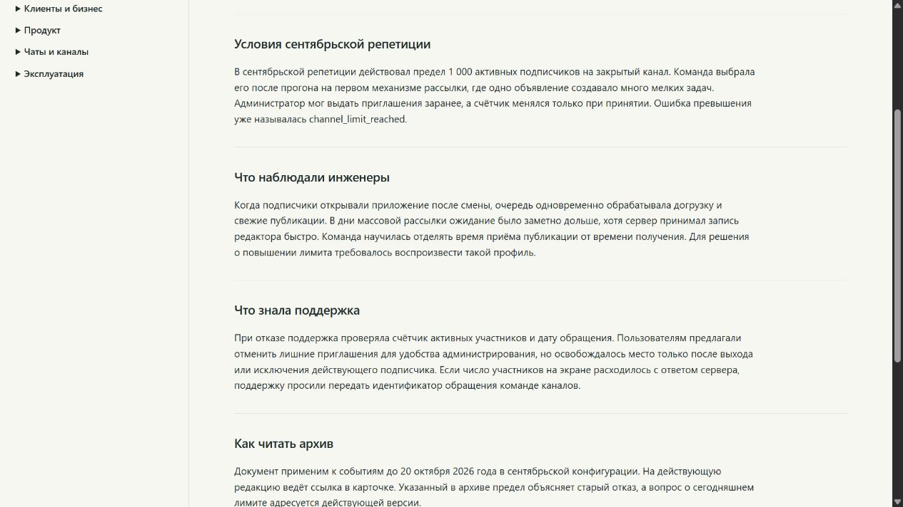
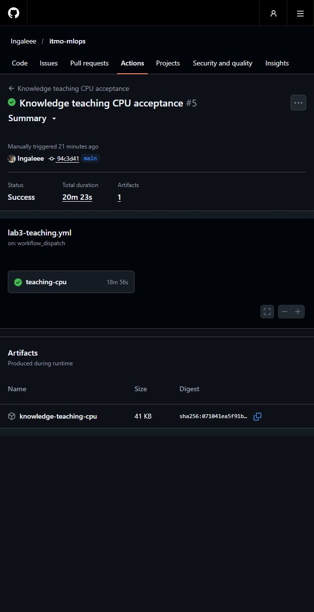

# Knowledge Portal — демонстрация

[Проект](README.md) · [Критерии](ACCEPTANCE.md) · [Результаты](../docs/validation.md#knowledge-portal)

Снимки сделаны в настоящем локальном портале, подключённом к отдельному MCP-процессу и Ollama CPU. Это демонстрация локального приложения; она не подменяет проверку учебного Kubernetes. Закрытый документ и секреты в кадры не включены.

## Видеообзор

[MP4, 25 секунд](../docs/media/lab3/portal-demo.mp4). Видео составлено из последовательности реальных браузерных снимков с кадрированием до viewport. Это обзор экранов, не непрерывная запись действий.

## Портал

Вход защищён отдельным токеном. Браузер работает только с backend портала. Дерево содержит 36 редакций; архивные версии не объединяются с действующими.

## Поиск

Результаты получены через MCP. Карточки показывают точную версию, статус и выдержки. [Независимая проверка MCP](../docs/media/sources/knowledge-mcp.json) содержит схемы трёх инструментов и источники контрольных вопросов.

## Настоящий CPU-ответ

Выбран локальный маршрут. Ответ и карта источников сформированы после поиска, а не заранее записаны в интерфейсе. [Проверка приватности](../docs/media/sources/knowledge-privacy.json) подтверждает происхождение открытых контрольных контекстов. [Отмена в настоящем runtime](../docs/media/sources/knowledge-native-cancellation.json) фиксирует доступность следующего запроса после отмены.

## Действующая редакция

Точный URL `/docs/M-05/2.0` открывает действующую редакцию с пределом 5000. Секция имеет собственный якорь.

## Архивная редакция

URL `/docs/M-05/1.1` отдельно открывает архив с прежним пределом 1000. Статус виден в метаданных.

SHA-256, размеры изображений, происхождение и связи с исходными данными записаны в [манифесте](../docs/media/manifest.json).

## Генерация в Kubernetes и сохранность весов

Отдельный Linux Kubernetes прошёл все восемь контрольных вопросов на CPU. [Ответы с точными источниками](../docs/media/sources/knowledge-kubernetes-controls.json) сохранены из реального API. [Замеры cgroup и проверка перезапуска](../docs/verification/lab3-kubernetes-local.json) показывают предел памяти, фактический пик и разные UID Pod до и после пересоздания. SHA-256 весов совпал, новый Pod снова ответил на К01.

Профиль локального k3d использует отдельный Docker volume. Результат чистого PVC в CI и доступность учебного namespace приводятся [отдельно](../docs/validation.md#knowledge-portal).

Чистый [CI Kubernetes](https://github.com/Ingaleee/itmo-mlops/actions/runs/44960841161) прошёл с опубликованными images: пустой PVC, все восемь CPU-ответов, пересоздание Pod, ограничение очереди, отмена и фильтрованный К01. [Отчёт CI](../docs/verification/lab3-kubernetes-ci.json) содержит фактические ответы, digest и измерения памяти без секретов и закрытого корпуса.

## CPU-приёмка на учебном стенде

Настоящая страница GitHub Actions: результат Success и сохранённый artifact. Проверка использовала исходный корпус только в персональном namespace, реальные MCP и Ollama CPU, опубликованные образы по digest.

| Контроль | Проверяемая тема | CPU, с | Результат |
|---|---|---:|---|
| K01 | Действующий лимит подписчиков | 52.8 | Пройден |
| K02 | Архивная редакция | 44.6 | Пройден |
| K03 | Публичные каналы и черновики | 62.2 | Пройден |
| K04 | Числовые пороги пилота | 67.7 | Пройден |
| K05 | Согласование резерва | 68.0 | Пройден |
| K06 | Итог и прирост стоимости | 62.4 | Пройден |
| K07 | Поддерживаемые платформы | 50.4 | Пройден |
| K08 | Неуказанный срок пилота | 43.4 | Пройден |

[Отчёт с ответами и точными источниками](../docs/verification/lab3-teaching.json) подтверждает также отказ третьему запросу при заполненной очереди, отмену активного и ожидающего запросов и следующий фильтрованный К01. После пересоздания Pod модель снова ответила; SHA-256 весов совпал, OOM и неожиданных рестартов нет.

После приёмки третий профиль остановлен из-за общей квоты памяти; первые две работы восстановлены, их внешние API проверены. Полный облачный маршрут этим запуском не проверялся.
