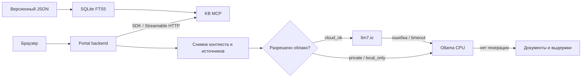

# LiraTech Knowledge Portal

[Каталог](../README.md) · [Условия](ASSIGNMENT.md) · [Критерии](ACCEPTANCE.md) · [Контрольные вопросы](control-questions.json) · [Запуск](RUNBOOK.md)

[Скриншоты и видео работающего портала](DEMO.md)

Поисковый портал по внутренней базе знаний мессенджера «Линия». Находит документы, открывает конкретную редакцию и формирует ответ с проверяемыми ссылками. Поиск сохраняет работоспособность при недоступной генерации.

Реализованы портал, независимый MCP-сервис, индекс, маршрутизация llm7.io/Ollama, ограничения CPU-очереди и Kubernetes-профиль. Границы фактической проверки приведены в [результатах](../docs/validation.md#knowledge-portal): локальная генерация не заменяет проверку установленного релиза в Kubernetes.

## Архитектура



MCP владеет хранением, редакциями, деревом и поиском. Портал владеет приватностью, отбором контекста, маршрутом, проверкой ссылок и представлением ответа. Модели получают выбранные отрывки без самостоятельного доступа к инструментам, файлам или сети. Протокол MCP реализует официальный SDK, HTTP-запросы — httpx без повторных попыток.

## Данные и поиск

Корпус содержит 36 редакций, 35 ID, 6 разделов, 12 подразделов. Ключ документа — `(id, version)`. По умолчанию поиск использует статус «Действует»; архив и черновики включаются фильтром. `/docs/M-05/2.0#s01` и `/docs/M-05/1.1#s01` открывают разные первоисточники.

Валидатор отклоняет дубли JSON-полей, редакций и якорей, неизвестные метки обработки, неправильную иерархию, даты и разорванные ссылки. Новый SQLite-файл проходит integrity check и публикуется атомарной заменой. Запрос использует один целостный generation.

FTS5 ранжирует секции по BM25. Русские формы нормализует pymorphy3; регистр, «ё/е», составные числа и синонимы обрабатываются одинаково при индексации и запросе. Path/status/version применяются до ранжирования. Ссылки лучшего лексического результата повышают связанные редакции, уже найденные с теми же фильтрами. Карточки уникальны по ID и версии; портал показывает до пяти.

```bash
python scripts/inspect_corpus.py /path/to/corpus.json
python scripts/check_privacy.py /path/to/corpus.json
```

Корпус не входит в Git, CI artifacts или публичные Docker images. В Kubernetes он поступает напрямую из локального файла в namespaced Secret. Опасная цитата закрытого документа сохраняется для точного просмотра оригинала, но исключена из поисковых выдержек и контекста моделей.

## MCP-контракт

| Инструмент | Вход | Ответ |
|---|---|---|
| list_sections | Без аргументов | Дерево и листы с ID/version/status/visibility |
| get_doc | Обязательные doc_id, version | Метаданные, секции, ссылки; отсутствующая редакция — tool error |
| search_docs | query, limit ≤10, path, statuses, ID/version | generation, уникальные карточки, ранги, отрывки и якоря |

Схемы входа и structuredContent объявлены через Pydantic и проверяются клиентом. MCP работает как отдельный ClusterIP-сервис `kb-mcp:8000/mcp`, требует сервисный Bearer token и проверяет Origin. Браузер обращается только к порталу.

## RAG и провайдеры

Портал выбирает 2–4 отрывка, сохраняя единый поисковый снимок. Карта источников и URL строятся сервером. Токенизатор выбранной модели закреплён SHA-256: промпт ограничен 1500 токенами при контексте 2048, ответ — 160. Модель возвращает структурированные факты с номерами источников. Непустой текст без корректных ссылок не считается ответом.

Отметки архива и черновика добавляются по метаданным использованных источников. Неизвестный номер, URL, HTML или повреждённый результат приводит к fallback; без пригодной генерации портал показывает search_only и документы.

| Маршрут | Профиль |
|---|---|
| Cloud | llm7.io, gemma-3-27b в учебном профиле; модель выбирается через CLOUD_MODEL |
| Local | Ollama 0.40.16, Qwen3-4B-Instruct-2507 GGUF Q4_K_M, CPU, 2 потока |
| Время | MCP 2 с, cloud 12 с, local с очередью 105 с; HTTP-запрос ограничен 122 с |

Для cloud выполняется одна попытка. 429 учитывает Retry-After в секундах или HTTP-date, без заголовка — 60 с. Для 5xx/transport/invalid response пауза 30 с, для ошибки конфигурации — 30 минут. После паузы допускается одна конкурентная проба. Подтверждённые коды quota задаются CLOUD_QUOTA_CODES: учебный профиль использует `quota_exceeded`, полученный в настоящем ответе llm7.io с типом `insufficient_quota`. Обычный 429 без этого кода остаётся ограничением частоты. При quota без Retry-After пауза 30 минут. Синтетический quota-контракт тестируется отдельно, настоящий API token в имитатор не передаётся.

CPU имеет один слот генерации и одно место ожидания. Следующий запрос получает search_only. Отмена HTTP-запроса освобождает очередь и закрывает исходящий вызов; фактическая отмена вычисления runtime проверяется отдельно.

## Приватность и доступ

Private, local_only или сомнительная метка любого найденного документа запрещают облачный вызов. Закрытые заголовки, фрагменты и производные не передаются llm7. check_privacy.py сверяет открытые контрольные контексты с исходными редакциями без внешних запросов.

Портал требует отдельный токен и использует HttpOnly/SameSite cookie. Профиль предназначен для localhost port-forward. MCP и Ollama не имеют внешних routes. Логи содержат request_id, маршрут, причину, latency и счётчики, без текстов вопросов, документов, ответов и Authorization.

## Проверки

```bash
pip install -r requirements-dev.txt
python model/fetch_tokenizer.py
python -m pytest -q --junitxml=evidence/tests.xml
python scripts/probe_mcp.py
python scripts/verify_portal.py --route cloud --portal-token-file /private/portal.token --output evidence/cloud-controls.json
python scripts/verify_portal.py --route local --portal-token-file /private/portal.token --output evidence/local-controls.json
```

Тесты используют синтетический корпус и провайдеров: настоящий процесс MCP, auth, Origin, exact revision, фильтры, приватность, переключение, паузы, восстановление, перегрузка и отмена. verify_portal.py вызывает настоящий портал и проверяет факты из К01–К08; mock не подменяет эту проверку.

Изолированный Kubernetes в CI получает отдельный public acceptance fixture: 35 записей с меткой cloud_ok и полностью синтетическую замену закрытой записи. Это отдельный корпус со своим SHA-256; оригинальная закрытая карточка не публикуется. CI проверяет опубликованные образы, настоящую CPU-модель, контрольные источники и генерацию после пересоздания Pod. Результат приводится отдельно от учебного стенда.

## Структура

```text
app/                 # MCP, поиск, портал, маршрутизация, UI и контракты
model/               # pinned runtime, Modelfile, загрузка GGUF и токенизатора
deploy/              # namespaced Kubernetes-профиль
scripts/             # проверка корпуса, MCP, privacy, E2E и deployment
testing/             # отдельный fault-provider только для тестов
tests/               # синтетические проверки контрактов и отказов
control-questions.json
requirements.lock
```

Команды, ресурсы и управление весами — в [RUNBOOK](RUNBOOK.md). Матрица требований — в [ACCEPTANCE](ACCEPTANCE.md).
